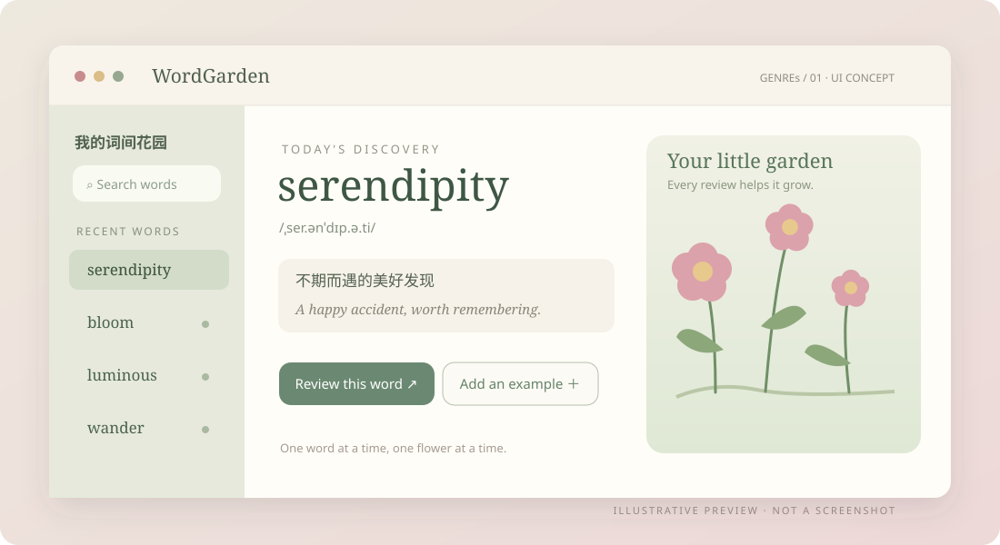

[README.md](https://github.com/user-attachments/files/34538507/README.md)
# WordGarden
A cozy desktop vocabulary garden to collect new words, practice recall, and watch your knowledge grow.
<p align="center">
  
</p>

<p align="center"><strong>Let your words grow into a little garden.</strong><br /><sub>让单词慢慢长成一座花园。</sub></p>

<p align="center"><code>GENREs / 01</code> · Electron · Windows · Vocabulary Learning</p>

**WordGarden** is a cozy desktop companion for collecting new English words, practicing recall, and enjoying the little progress you make each day. Every word you revisit helps your personal garden grow.

### ✦ What you can do

| Collect | Practice | Grow |
| :--- | :--- | :--- |
| Save words, meanings, and example sentences; search your collection | Review with mini quizzes and track your familiarity | Turn learning progress into a visual garden |

Also includes **multiple learner profiles**, **quick desktop word capture**, and optional online dictionary and translation lookups.

### ✦ A closer look

<p align="center"></p>

<sub>Illustrative UI concept based on actual features. Sample words are fictional; this is not an application screenshot.</sub>

### ✦ Get started

Install **Node.js ≥ 22.12** and npm. From the project directory, run:

```bash
npm ci
npm start
```

On Windows, you can also double-click `word.cmd` after running `npm ci`. This is a **source-code release**, not a packaged `.exe` installer.

### ✦ Data & privacy

- Your vocabulary is stored **locally** in WordGarden's application data directory; no personal learning history is included in this repository.
- Dictionary or translation requests may contact **Free Dictionary API / MyMemory** and require internet access.
- Review activities support learning; please verify important definitions independently.

<details>
<summary><strong>🇨🇳 简体中文 · 中文介绍</strong></summary>

**词间花园（WordGarden）**是一款轻量桌面英语学习工具。收集喜欢的单词、记录释义和例句，再通过小测验和进度反馈慢慢记住它们；每一次复习，都让自己的花园更丰富。

- **收集**：单词、释义、例句、搜索与桌面快捷收词。
- **记忆**：小测验、复习进度与熟练度反馈。
- **成长**：可视化花园、多用户词库。
- **运行**：安装 Node.js ≥ 22.12，依次执行上方的 `npm ci`、`npm start`；Windows 也可使用 `word.cmd`。
- **隐私**：学习记录保存在本机；在线词典／翻译功能需要联网。

上方图片为功能示意图，并非程序实际截图。

</details>

<p align="center"><sub>Made with curiosity, by <strong>GENREs</strong> · Little tools, lovingly made.</sub></p>
